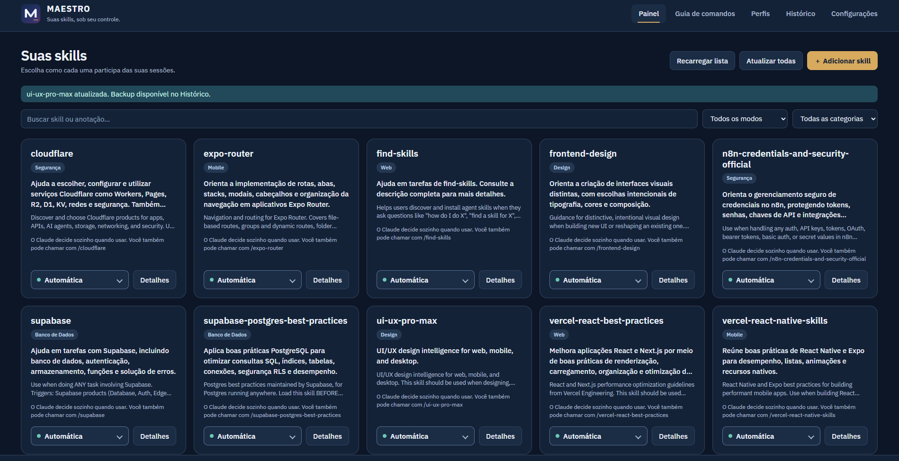

# Maestro

Aplicativo de desktop para Windows que gerencia skills do Claude Code. Permite escolher o modo de cada skill, manter perfis, consultar histórico e instalar skills de repositórios confiáveis.



## Requisitos

- Windows 10 ou 11.
- Node.js LTS e npm para desenvolver ou gerar o instalador. A instalação de skills pela internet também precisa de Node.js.
- Git no `PATH` para verificar e atualizar skills vindas de repositórios.
- Claude Code para usar as skills gerenciadas.

## Instalação e desenvolvimento

No PowerShell, a partir da pasta do projeto:

```powershell
npm.cmd ci
npm.cmd start
```

O Maestro usa `%USERPROFILE%\.claude\skills` por padrão. É possível escolher outra pasta em **Configurações**. O catálogo inicial está em `dados/catalogo.json`; dados pessoais, perfis e backups da aplicação ficam em `%APPDATA%\Maestro`.

## Uso

No painel, selecione **Automática**, **Só manual** ou **Desligada** para cada skill. Em **Só manual**, use o comando `/nome-da-skill` mostrado no card ou no Guia de comandos. Use **Perfis** para guardar conjuntos de modos e **Histórico** para restaurar alterações. Reinicie a sessão do Claude Code para que ele reconheça mudanças nas skills.

Em **Adicionar skill**, você pode criar uma skill, importar uma pasta ou instalar de um repositório HTTPS confiável. Revise a prévia antes de instalar: skills de terceiros podem executar código. O painel também detecta skills adicionadas ou removidas fora do Maestro.

Quando o Maestro conhece a origem de uma skill, o card pode mostrar **Atualização disponível**. Use **Atualizar** no card ou **Atualizar todas** no topo. A atualização mantém o modo e os dados do catálogo, cria um backup e pede confirmação se houver alterações locais ou se a instalação antiga não tiver uma versão de referência registrada.

## Verificações e build

```powershell
npm.cmd run lint
npm.cmd test
npm.cmd run dist
```

`lint` verifica a sintaxe dos arquivos JavaScript; `test` executa os testes com o runner do Node.js. `dist` gera ícones e um instalador NSIS em `dist/Maestro-Setup-VERSÃO.exe`. O build atualiza `dados/build.json` e `release-manifest.json` e pode arquivar instaladores anteriores em `dist/anteriores`. Esses arquivos gerados não entram no Git. O script `release` publica no GitHub Releases e exige credenciais e certificado; use-o somente para uma publicação deliberada.

## Contribuição

Abra uma issue para discutir mudanças maiores. Para contribuir com código, faça uma branch, mantenha as alterações focadas, atualize os testes quando o comportamento mudar e execute lint, testes e build antes de propor um pull request. Para uma nova versão, atualize `package.json`, `package-lock.json` e `NOVIDADES.md`; o build confere a versão com o código. Não inclua dados de `%APPDATA%`, credenciais, backups, instaladores ou `node_modules`.

Veja [LEIAME.md](LEIAME.md) para mais detalhes de uso e [NOVIDADES.md](NOVIDADES.md) para o histórico de versões.
